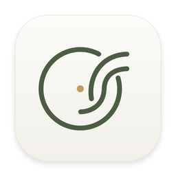

<div align="center">
  
  <h1>CreatorRelay</h1>
  <p><strong>本地优先、AI 驱动的多平台创作者工作台（Unified Creator Workspace）</strong></p>
  <p>
    在一个桌面应用中统一管理多平台账号、四类内容创作、跨平台发布任务、作品数据聚合与受控 AI/MCP 工作流。
  </p>

  <p>
    <a href="https://github.com/AlkaidSTART/CreatorRelay/releases">
      
    </a>
    <a href="https://github.com/AlkaidSTART/CreatorRelay/actions/workflows/release.yml">
      
    </a>
    
    
    
    
  </p>

  <p>
    <a href="#为什么选择-creatorrelay">为什么选择我们</a> •
    <a href="#核心特性">核心特性</a> •
    <a href="#支持平台">支持平台</a> •
    <a href="#架构与技术栈">架构与技术栈</a> •
    <a href="#下载安装">下载安装</a> •
    <a href="#本地开发">本地开发</a> •
    <a href="#文档索引">文档索引</a> •
    <a href="#自动发版">自动发版</a>
  </p>
</div>

---

## 项目简介

多平台内容创作者通常面临账号分散、各平台编辑结构不统一、发布状态难以追踪、运营数据口径割裂，以及 AI 工具无法安全接入真实创作资产等问题。

**CreatorRelay** 旨在为个人创作者、技术博主与多平台内容运营者提供一个 **Local-first** 的统一桌面工作台，围绕以下四个核心理念构建：

- **Local-first（本地优先）**：内容包、Markdown 正文与媒体素材默认保存在用户本机工作区；SQLite 仅保存索引与业务元数据，不反向覆盖用户文件。
- **Platform-agnostic（平台无关）**：通过标准化的 Platform Adapter 与平台专属 MCP Profile 接入不同平台，清晰声明各平台真实能力边界。
- **AI-native（原生 AI 编排）**：支持 BYOK（用户自带 API Key 及 OpenAI Compatible 接口），通过内置 MCP Host 在用户授权下执行跨模块查询、内容适配与受控发布。
- **Safe & Extensible（安全可扩展）**：敏感凭据经操作系统安全凭据库（Keychain）管理，任何发布、删除或外部副作用均需用户明确确认。

---

## 为什么选择 CreatorRelay？

如果你同时运营 **3 个以上内容平台**（例如 B 站 + 小红书 + 微信公众号 + 掘金/YouTube），日常工作往往被拆得支离破碎：开十几个标签页切号、同一份稿子手动改五遍、在聊天式 AI 里反复复制粘贴上下文、复盘时逐个登录后台导数据。CreatorRelay 把这条链路收口到一个**数据归你、账号安全、AI 可直接协作**的本地桌面工作台里。

### 与常见方案对比

| 痛点场景 | 浏览器多标签页（纯手工） | 云端多平台分发 SaaS | **CreatorRelay** |
| :--- | :--- | :--- | :--- |
| **多形态内容管理** | 视频、图文、文章散落在不同文件夹和网页草稿箱，版本与状态全靠人脑记 | 绑定云端编辑器，导出与迁移成本高 | **统一本地内容包**管理视频 / 图文 / 图文文章 / 纯文章，Markdown 正文优先、版本可回溯 |
| **数据与隐私主权** | 散落在各平台草稿箱，难以统一检索与备份 | 文稿与素材存第三方服务器，受限于订阅与服务存续 | **Local-first 本地优先**：文稿与素材全部存在你的硬盘，SQLite 仅作索引不覆盖原文件 |
| **账号与风控安全** | 频繁切号掉登录、多账号会话互相串扰 | 需向第三方托管 Cookie 或账号授权，存在泄露与封号风险 | **系统 Keychain 凭据存储 + 隔离浏览器会话**；无官方自动发布接口的平台仅提供受控人工辅助，绝不绕过风控 |
| **AI 创作协同** | 每次手动把稿子和数据贴进聊天框，改完再手动搬运回来 | 多为黑盒模板改写，常按字数/次数额外计费 | **内置 MCP Host + BYOK**：自带 API Key 直连多模型，AI 在授权下直接读取本地稿件与真实数据、生成适配稿与待确认发布任务 |
| **跨平台复盘** | 逐个登录创作者后台看数据、手工汇总 | 指标口径黑盒或强行对齐导致失真 | **多平台聚合看板**：保留各平台原始指标口径，仅展示真实采样点，不伪造补零 |

### 典型工作流

```text
① 本地一次创作            ② AI 跨平台适配            ③ 受控发布与交接           ④ 统一数据复盘
视频 / 图文 / 文章   ──▶   MCP 读取主稿与历史数据  ──▶  发布前校验与目标预览  ──▶  跨平台作品聚合
Markdown + 素材包          生成各平台差异化适配稿       人工逐次确认后执行         真实指标趋势分析
```

### 适用与边界

- **最适合**：多平台个人创作者、技术博主、独立内容运营者，以及希望把创作资产沉淀在本地并用自有模型（BYOK）提效的创作者。
- **不适合**：仅深耕单一平台的用户、需要专业视频剪辑/修图工具的场景，或寻求「无人值守全自动群发、绕过验证码与平台风控」的用途。

---

## 核心特性

### 1. 内容工作室（Studio）
- 支持 **视频、图文、图文文章、纯文章** 四类内容形态的统一管理与编辑。
- 采用「本地内容包 + 文章类 Markdown 正文优先」存储模型，支持素材管理、全文检索与版本历史追踪。
- 内置 AI 辅助创作与多平台适配稿生成，支持按目标平台规则生成标题、摘要与元数据。

### 2. 多平台账号与会话隔离（Platforms）
- 采用 `Platform → Account → Session` 三级模型，支持单平台多账号集中管理。
- 密码、Cookie、Token 与 API Key 等敏感信息不明文落库或写入日志，优先通过系统 Keychain 管理。
- 支持隔离浏览器会话与创作者中心快速导航，避免与日常浏览器环境相互干扰。

### 3. 分发与发布管理（Publishing）
- 按平台与账号维度独立创建和跟踪发布任务、发布计划与执行结果。
- 发布前提供内容规则校验与目标预览；对于不支持自动发布的平台，提供清晰的人工交接路径。
- 执行外部发布或删除等高风险动作前强制用户一次性确认，超时或结果不确定时不盲目重试。

### 4. 作品聚合与运营分析（Content & Analytics）
- 跨平台聚合已发布作品，支持统一检索与增量同步。
- 保留各平台原始指标口径并记录历史指标快照，通过 Dashboard 与 ECharts 图表直观展示运营趋势与异常提醒。

### 5. 本地 MCP Host 与 AI 助手（Assistant）
- 内置 Rust MCP Host（stdio JSON-RPC）与 Schema 校验层，按 **Read / Write / External Action** 三级权限治理工具调用并记录审计日志。
- 将平台字段差异拆分至独立的平台 MCP Profile，提供账号读取、作品分页/增量查询、发布校验、素材暂存与受控提交等能力。

### 6. 插件与生态扩展（Adapters & Ecosystem）
- 提供标准化的 Adapter Manifest、运行时隔离合约与生命周期管理。
- 内置平台准入、兼容性检查与插件市场治理机制，支持官方与第三方适配器扩展。

---

## 支持平台

CreatorRelay 已内置以下 10 个主流内容平台的账号目录与专属 MCP Profile（位于 `src-tauri/src/mcp/platform_mcp/`）：

| 平台 | 主要内容形态 | MCP Profile 模块 |
| --- | --- | --- |
| **Bilibili** | 视频、专栏 | `bilibili_mcp.rs` |
| **抖音** | 短视频、图文 | `douyin_mcp.rs` |
| **快手** | 短视频 | `kuaishou_mcp.rs` |
| **小红书** | 图文、视频 | `xiaohongshu_mcp.rs` |
| **YouTube** | 视频、频道 | `youtube_mcp.rs` |
| **微信公众号** | 图文、视频 | `wechat_mcp.rs` |
| **知乎** | 问答、文章 | `zhihu_mcp.rs` |
| **微博** | 社交动态 | `weibo_mcp.rs` |
| **掘金** | 技术文章 | `juejin_mcp.rs` |
| **CSDN** | 技术博客 | `csdn_mcp.rs` |

> [!NOTE]
> **合规与能力边界说明**：列入平台目录不代表所有平台均支持全自动接口发布。CreatorRelay 坚持不绕过验证码、登录校验或平台风控；在账号级授权与平台能力未验证通过前，默认采用人工发布交接或逐次确认的受控流程。

---

## 架构与技术栈

### 系统架构

```text
React 19 Desktop UI (Studio / Platforms / Publishing / Content / Analytics / Assistant)
        │ Tauri IPC Commands
        ▼
Rust Core Service (src-tauri/src)
  ├── Local Workspace & Content Packages (Markdown + Media Assets + Git/Snapshots)
  ├── SQLite Index & Metadata (rusqlite)
  ├── OS Credential Store (keyring)
  ├── Platform Adapter Runtime & Ecosystem Governance
  └── Local MCP Host (stdio JSON-RPC + Permission Guard + Audit Log)
        ├── Core Tools & 10 Platform MCP Profiles
        └── Isolated Creator Browser Bridge (user-confirmed actions)
```

### 技术栈

| 层级 | 技术选型 |
| --- | --- |
| 桌面框架 | [Tauri v2](https://v2.tauri.app/) · Rust (Edition 2024) |
| 前端框架 | React 19 · TypeScript · Vite · React Router · Zustand |
| 样式与可视化 | Tailwind CSS v4 · Lucide Icons · Motion · ECharts · React Markdown |
| 本地存储与安全 | SQLite (`rusqlite` bundled) · OS Keychain (`keyring`) · `git2` |
| 工程与测试 | pnpm 10 · Vitest · Oxlint · Prettier · Cargo Test |

### 目录结构

```text
CreatorRelay/
├── src/                      # React + TypeScript 前端应用
│   ├── pages/                # 各功能页面（Dashboard / Studio / Publishing / Content / Analytics / Assistant / Platforms / Settings 等）
│   ├── components/           # 通用与业务 UI 组件
│   ├── stores/               # Zustand 状态管理
│   └── types/ & utils/       # 类型定义与工具函数
├── src-tauri/                # Tauri v2 + Rust 后端核心
│   ├── src/
│   │   ├── commands/         # Tauri IPC 命令入口
│   │   ├── content/          # 内容包与工作区读写
│   │   ├── platforms/        # 平台目录、账号与会话管理
│   │   ├── plugins/          # Adapter 运行时与插件管理
│   │   ├── operations/       # 发布、同步与运营数据
│   │   └── mcp/              # MCP Host 及 platform_mcp/ 平台工具集
│   └── resources/plugins/    # 内置参考与测试适配器
├── docs/                     # PRD、功能实现说明与架构决策记录（ADR）
├── progress/                 # 里程碑（M1–M8）追踪、验证记录与验收报告
└── .github/workflows/        # GitHub Actions 跨平台自动构建与发版工作流
```

---

## 下载安装

前往 [GitHub Releases](https://github.com/AlkaidSTART/CreatorRelay/releases) 下载对应平台的预构建安装包：

- **macOS**：Universal `.dmg`（同时支持 Apple Silicon 与 Intel）
- **Windows**：NSIS `.exe` 安装包
- 每次发版均附带 `SHA256SUMS.txt` 以便校验安装包完整性。

> [!TIP]
> Windows 安装包当前未配置代码签名，首次运行时 Windows SmartScreen 可能会提示未知发布者；macOS 未配置公证 Secrets 时同理。如需完全信任构建产物，也可以直接从源码本地构建。

---

## 本地开发

### 环境要求

- **Node.js**：22+
- **pnpm**：10+
- **Rust**：Stable 工具链（支持 Edition 2024）
- **Tauri v2 系统依赖**：请参考 [Tauri 官方前置条件指南](https://v2.tauri.app/start/prerequisites/)

### 快速启动

```bash
# 1. 克隆仓库
git clone https://github.com/AlkaidSTART/CreatorRelay.git
cd CreatorRelay

# 2. 安装前端依赖
pnpm install

# 3. 启动桌面应用开发模式（自动拉起 Vite 与 Tauri 窗口）
pnpm dev
```

### 常用命令

```bash
# 仅启动前端开发服务
pnpm dev:web

# 类型检查 / 代码检查 / 格式化检查
pnpm typecheck
pnpm lint
pnpm format:check

# 运行前端单元测试
pnpm test

# 运行 Rust 后端测试
cargo test --manifest-path src-tauri/Cargo.toml

# 构建前端产物
pnpm build

# 打包当前平台桌面安装包
pnpm tauri build
```

### 推荐 IDE 配置

- [VS Code](https://code.visualstudio.com/) + [Tauri](https://marketplace.visualstudio.com/items?itemName=tauri-apps.tauri-vscode) + [rust-analyzer](https://marketplace.visualstudio.com/items?itemName=rust-lang.rust-analyzer)

---

## 文档索引

### 产品与架构文档

- [产品需求文档（PRD V0.4）](./docs/CreatorRelay-PRD-v0.4.md)
- [M1 桌面基础设施实现说明](./docs/m1-desktop-foundation.md)
- [本地内容工作区格式说明](./docs/local-workspace-format.md)
- [平台账号、凭据与会话实现说明](./docs/platform-accounts.md)
- [Adapter 与插件体系实现说明](./docs/adapters.md)
- [内容工作室实现说明（M5）](./docs/content-studio.md)
- [发布、同步与运营数据实现说明（M6）](./docs/m6-publishing-operations.md)
- [MCP Host、工具权限与 Assistant 运行说明（M7）](./docs/mcp-agent.md)
- [平台 MCP 拆分与接口映射](./docs/platform-mcp.md)
- [生态扩展、平台准入与插件市场治理（M8）](./docs/ecosystem-expansion.md)

### 架构决策记录（ADR）与里程碑

- [ADR-001：文章版本历史方案](./docs/adr/ADR-001-article-version-history.md)
- [ADR-002：Adapter 运行时决策](./docs/adr/ADR-002-adapter-runtime.md)
- [ADR-003：插件市场治理决策](./docs/adr/ADR-003-plugin-marketplace.md)
- [阶段里程碑总览（M1–M8）](./progress/README.md)

---

## 自动发版

CI/CD 发版工作流位于 [`.github/workflows/release.yml`](./.github/workflows/release.yml)。每次推送或合并到 `main` 分支（或通过 Actions 页面手动触发 `workflow_dispatch`）都会自动执行：

1. 在 macOS 上构建 Universal `.dmg`（Apple Silicon + Intel）
2. 在 Windows 上构建 NSIS `.exe`
3. 校验构建产物并生成 `SHA256SUMS.txt`
4. 创建或更新对应的 GitHub Release，并自动生成变更说明

**版本号规则**：由 `package.json` 的基础版本和 GitHub Actions 运行序号组合而成（例如基础版本为 `0.1.0`、运行序号为 `12` 时，构建版本为 `0.1.12`）。该版本仅在 CI 构建阶段写入，不会回写仓库。

<details>
<summary>macOS 签名与公证配置（可选）</summary>

如需启用 macOS 代码签名与公证，请在仓库 `Settings → Secrets and variables → Actions` 中配置以下 Secrets：

- `APPLE_CERTIFICATE`
- `APPLE_CERTIFICATE_PASSWORD`
- `APPLE_ID`
- `APPLE_PASSWORD`
- `APPLE_TEAM_ID`
- `KEYCHAIN_PASSWORD`（可选）

如果 Release 上传步骤出现权限错误，请在仓库 `Settings → Actions → General → Workflow permissions` 中开启 **Read and write permissions**。

</details>

---

## 参与贡献

欢迎通过 Issue 反馈问题、提出新平台适配建议，或直接提交 Pull Request：

1. Fork 本仓库并从 `main` 创建特性分支（如 `feat/your-feature` 或 `fix/your-bug`）。
2. 完成代码与文档修改，确保本地检查全部通过：
   ```bash
   pnpm typecheck && pnpm lint && pnpm test
   cargo test --manifest-path src-tauri/Cargo.toml
   ```
3. 涉及阶段里程碑变更时，请同步遵循 [`AGENTS.md`](./AGENTS.md) 与 [`progress/README.md`](./progress/README.md) 中的验收与文档记录规范。
4. 提交清晰的 Pull Request 描述并关联对应 Issue。
